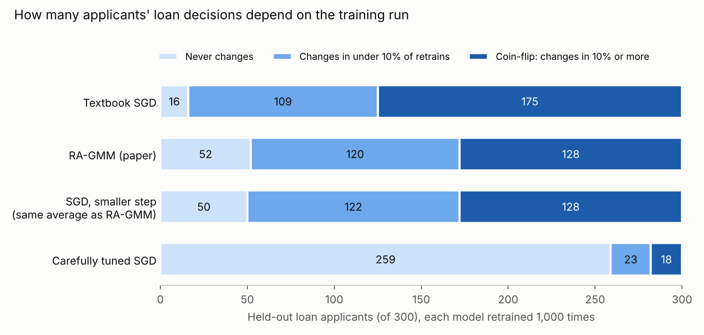

# Same applicant, same data, different answer

### What retraining does to loan decisions, who it affects most, and what a risk-averse training method can do about it

*Data: German Credit (1,000 real loan applications from a German bank, a standard public dataset). All numbers are
reproducible with the commands at the end. Analysis plan written before running: `PLAN.md`.*

---

## 1. The problem: a model is not one model

When a bank trains a credit-scoring model, the training process uses randomness: it looks at the applicants in a
random order, a few at a time, and nudges the model after each small batch. Run the training again on **exactly the
same data** and you get a slightly different model.

How different? We trained the same simple, widely used credit model (logistic regression) **1,000 times** on the same
700 past applicants, changing nothing but the random order, and asked each of the 1,000 models to decide on 300 new
applicants it had never seen (approve if it thinks the applicant is at least 50% likely to repay).

With the textbook training settings:

* each retrained model decided **55 of the 300 applicants (18%) differently** from the exactly-trained model;
* **284 of the 300 applicants** got a different answer from at least one retrain; only 16 got the same answer every time;
* **175 applicants (58%) were "coin-flip" applicants**: their decision changed in at least one retrain out of ten.



Nothing about these applicants changed. Only the luck of the training run did.

## 2. Why look at the tail, not the average

Averages hide bad days. A bank does not retrain once; it retrains every month or quarter. Most retrains are fine.
Some are noticeably worse. The question a risk manager asks is not "how good is a typical retrain?" but **"how bad is
a bad one, and who pays for it?"**

In this report "tail" has two concrete meanings:

* **Tail retrains (the bad months).** Score each retrain by how well it fits the training data (its training loss;
  lower is better). The **tail** is the worst 1 in 20 retrains (5%). In those, the textbook model changed **67
  decisions** instead of the usual 55, and its accuracy fell from 69.1% to 67.9%.
* **Tail applicants (who pays in the bad months).** In those worst retrains, the extra error is not spread evenly.
  For each applicant we measure how much worse the bad retrains are for them than the exactly-trained model. The
  **tail applicants** are the 5% (15 of 300) for whom it is worst.

## 3. Who are the tail applicants?

They are not random. Compared with the other applicants:

| Characteristic | Tail applicants | Everyone else |
|---|---|---|
| Currently unemployed | **60%** | 6% |
| Job: "unemployed / unskilled, non-resident" | **33%** | 2% |
| Job: "management / self-employed / highly qualified" | **47%** | 12% |
| No property (or unknown) | **40%** | 10% |
| Housed for free (not owner, not renter) | **33%** | 6% |
| Job: "skilled employee / official" (the most common job) | 13% | 65% |
| Exactly-trained model's probability of repaying (median) | **0.53** (close to the line) | 0.79 |

The common thread: **they are unusual compared with most past applicants.** Few people in the data share their
combination of job, employment and housing, so the data pins down how to score them only loosely. A statistician
would say they have **high leverage**: their score depends on parts of the model that the data barely determines
(here 2.7 times the leverage of the median applicant). Those are exactly the parts that move the most from one
training run to the next.

This is not specific to this dataset. In five other public datasets the same thing happened: the people who absorb a
bad retrain are those who look least like the majority. In US census income data they were mostly people born outside
the US (89% vs 6%), in COMPAS young people with juvenile records, in bank marketing clients contacted during the
2008–2010 low-interest-rate period, in diabetes screening people with extreme measurements
(`research/tail_analysis/RESULTS.md`).

## 4. Their loan decisions are the ones that switch

Because their scores move the most, their decisions are the ones that flip:

* **87% of tail applicants are coin-flip applicants** (decision changes in at least 10% of retrains), against 57% of everyone else;
* on average their decision differs from the exactly-trained model's in **28% of retrains** (others: 18%);
* and they can be found **before any retraining**: leverage, computed from a single fit, picks out the coin-flip
  applicants with an accuracy (ROC AUC) of **0.95**.

Three real applicants from the held-out data (all three **did repay**; the exactly-trained model approves all three):

| Applicant | How often approved by the 1,000 textbook retrains | ... by carefully tuned training |
|---|---|---|
| New-car loan, 1,549 DM over 9 months; job "unemployed / unskilled, non-resident"; employed under 1 year | **45%** | 81% |
| New-car loan, 1,175 DM over 16 months; unemployed; housed for free | **46%** | 42% |
| TV / radio, 3,758 DM over 24 months; unemployed; no property; renting | **46%** | 72% |

For these people, whether the loan is approved depends on the training run about as much as on a coin toss.

> **Disclaimer.** This report describes a statistical property of training procedures: how much a model's outputs
> vary between training runs and which applicants are most affected. It is **not an accusation** of bias,
> discrimination or wrongdoing against any lender, dataset creator or method, and not legal, credit or compliance
> advice. The concern it illustrates (that models can give different answers to the same person depending on
> arbitrary choices) is discussed in the machine-learning literature under names such as *predictive multiplicity*
> and *model arbitrariness*. Protected attributes (sex, age, foreign-worker status) were removed before training.

## 5. So the tail of training matters, and there is theory for it

If the cost of a bad retrain falls on a predictable group of people, then improving the **worst** retrains, not just
the average one, is worth doing. That is the subject of the paper this project is built on:

> Bugra Can and Mert Gürbüzbalaban, *Entropic Risk-Averse Generalized Momentum Methods*, Optimization Methods & Software (2025), arXiv:2204.11292.

In plain terms: training methods have a few dials: how big each step is (**step size**) and how much of the
previous step to carry forward (**momentum**). The paper measures the **worst case** of a training run with a tail
risk measure (EV@R, the entropic value at risk, a cautious upper bound on the bad-month loss), proves how that worst
case depends on the dials, and chooses the dials that make the worst case smallest while still training almost as
fast as possible. The method is called **RA-GMM** (risk-averse generalized momentum method). It needs only three
numbers about the problem (how curved the loss is, at most and at least, and the number of features) and **no trial
runs**.

On this dataset RA-GMM chose a small step (1/100 of the textbook step) with strong momentum (0.98).

## 6. Results: what RA-GMM changes

Same 1,000 retrains, same random orders, same 300 new applicants:

| Training method | Decisions changed per retrain (avg) | ... in the worst 5% of retrains | Coin-flip applicants | Accuracy | Training loss in the worst 5% (vs the exact model) | Trial runs needed |
|---|---|---|---|---|---|---|
| Textbook SGD | 55.2 | 78.8 | 175 | 69.0% | 0.374 | 0 |
| **RA-GMM (paper)** | **40.0** | **59.3** | **128** | **70.9%** | **0.140** | **0** |
| SGD with a smaller step (tuned to match RA-GMM's average) | 40.0 | 59.3 | 128 | 70.7% | 0.132 | 3,100 |
| Carefully tuned SGD (step tuned + averaging the last half of training) | 5.7 | 10.3 | 18 | 73.3% | 0.0015 | 240 |

**What RA-GMM achieves.** With no trial runs, RA-GMM cut decision changes by **15.2 per retrain** compared with the
textbook settings (95% confidence interval 14.4 to 16.0), turned **47 coin-flip applicants** into stable ones, cut the
worst-case training loss by **63%**, and improved accuracy slightly. The same holds on the other five datasets
(changed decisions 3.3–13.3% with RA-GMM vs 5.2–21.5% with textbook SGD, `research/gate0/RESULTS.md`).

**What it does not achieve (stated plainly).**

* Plain SGD with a step size chosen to give the same average quality does just as well (difference −0.03 decisions,
  interval −0.7 to +0.6). RA-GMM's gain comes from choosing a smaller step automatically; it does not give a better
  worst case than SGD at the same average (`research/tail_analysis/RESULTS.md`).
* Carefully tuned SGD with averaging is far better: 5.7 changed decisions and 18 coin-flip applicants. It costs 240
  trial runs to tune; RA-GMM costs none. RA-GMM's practical value here is a principled no-tuning default, not the
  best possible stability.

**Who still flips.** With RA-GMM, 80% of tail applicants are still coin-flip applicants (others 41%), and leverage still
identifies them (ROC AUC 0.92). With carefully tuned SGD only 27% are (others 5%). Better training shrinks the problem
but the people at risk are the same kind of people, and they can be identified in advance.

## 7. Two ways to get it wrong: denying a good customer, approving a bad one

Decisions can be wrong in two costly ways. Among the 300 new applicants, **210 went on to repay** and **90 did not**
(German Credit's "bad credit" label). Across the 1,000 retrained models:

**Wrongly denied** = a good applicant (would have repaid) who is refused. **Wrongly approved** = a bad applicant
(defaulted) who is given the loan. Decision rule as before: approve at a 50% repayment probability. Because a default
costs a bank far more than a lost customer (the dataset's own cost matrix says 5 to 1), we also show the stricter
cost-based rule (approve only at 83% or more), which a lender would normally use.

| Averages over 1,000 models | Textbook SGD | **RA-GMM** | Carefully tuned SGD | Exactly-trained model (no training noise) |
|---|---|---|---|---|
| **Rule: approve at 50%** | | | | |
| Good applicants wrongly denied | 19.4% (40.6 people) | **16.0% (33.6)** | 12.8% (27.0) | 12.9% (27) |
| Bad applicants wrongly approved | 58.1% (52.3 people) | 59.7% (53.7) | 58.9% (53.0) | 58.9% (53) |
| Errors caused by the training run (not made by the exact model) | 34.0 per model | **23.6** (-31%) | 2.8 (-92%) | 0 |
| **Rule: approve at 83% (cost-based)** | | | | |
| Good applicants wrongly denied | 39.1% | 44.1% | 48.7% | 48.1% |
| Bad applicants wrongly approved | 31.9% (28.7 people) | **23.2% (20.9)** | 14.0% (12.6) | 14.4% |
| Share of approved loans that default | 18.2% | **15.0%** | 10.5% | 10.7% |
| Cost per applicant (default = 5, lost customer = 1) | 0.753 | **0.657** (-13%) | 0.551 (-27%) | 0.553 |

### Wrongly denied: who they are

Averaged over models, 16-19% of the good applicants are turned away, and the same kind of person is turned away
repeatedly:

* **82% of RA-GMM's wrongful denials involve applicants with a checking account under 200 DM** (negative balance 43%,
  0-200 DM 39%), although only 44% of good applicants look like that. For textbook SGD it is 75%.
* **34% involve a long or large loan** (over 24 months or over 4,000 DM), vs 19% / 20% of good applicants.
* The 5% of good applicants most often refused (about 10 people) account for 25% of all wrongful denials under
  RA-GMM (18% under textbook SGD).

Of these denials, 27 per model are made even by the exactly-trained model: with this simple model, thin-balance
applicants look riskier than they are. The remaining ones are **caused by the training run**: 23.3 per model with
textbook SGD, **14.9 with RA-GMM** (-36%), 1.9 with careful tuning. Those
people are mostly applicants with a 0-200 DM balance (41% of RA-GMM's training-induced denials vs 23% of good
applicants), buying a new car (28% vs 18%) or furniture (27% vs 19%): applicants near the line that the model
itself finds ambiguous.

### Wrongly approved: who they are

Defaulters who get the loan are harder to characterize, because the model approves them precisely when they look like
good customers. Their common traits are being **without a checking account (34% of RA-GMM's wrongful approvals vs 22%
of defaulters)**, owning real estate (32% vs 24%), and borrowing for a TV or radio (30% vs 26%); the over-representation
is mild (1.2-1.5x), unlike the denial case. The training-induced share (people the exact model would have refused) is
10.8 per model for textbook SGD and **8.7 for RA-GMM** (-19%), concentrated on applicants with no or unknown property
(31% vs 13% of defaulters) or seven-plus years of employment (29% vs 13%): profiles that look reliable on paper.

### What RA-GMM changes, and why

* **It reduces the errors the training run adds.** Per model, 34.0 decisions that the exact model gets right are
  wrong because of training noise with textbook SGD; with RA-GMM that is 23.6. Its smaller step size and
  momentum average out the random order of the training examples, so each retrain lands closer to the exactly-trained
  model.
* **With the 50% rule, that shows up as fewer wrongly denied good customers** (-7.1 people per model, interval -7.7 to
  -6.5), but not as fewer wrongly approved defaulters: the exact model itself approves 53 of the 90 defaulters at
  50%, so RA-GMM's retrains drift toward that (53.7 vs 52.3, +1.5, interval +0.9 to +2.0). Training noise had been
  accidentally refusing a few extra defaulters at random.
* **With the cost-based rule, the bank benefits clearly:** 8 fewer defaulters wrongly approved per model (28.7 to
  20.9), the default rate among approved loans from 18.2% to 15.0%, and 13% lower expected cost. The price is more good
  customers refused (39% to 44%), because the cost-based rule refuses many by design.
* **The limit is the model, not the training.** What remains with RA-GMM at 50% (33.6 denials, 53.7 approvals) is
  mostly what the exactly-trained model does as well: 27 and 53. Training can remove the noise; only better features
  or a better model can remove those. Plain SGD with a step size matched to RA-GMM's average gives the same numbers
  (denied -0.6, approved +0.1, within the interval for approved), and careful tuning removes nearly all training-
  induced errors (2.8 per model), at 240 trial runs.

### Why it matters

**For the customer.** A refusal that depends on the luck of a training run is not a decision about them. With textbook
training about 40 of 210 good applicants in a batch like this one are refused; about 23 of those are refused only
because of the run. Moving to RA-GMM spares about 7 of them per model, and careful tuning about 21. The people
affected are not random: the same unusual, borderline profiles bear the cost of every bad run.

**For the bank.** Each wrongful denial is lost interest income and a lost customer; each wrongful approval is a loss
that, at the dataset's 5:1 ratio, costs five times as much. Under the cost-based rule the exactly-trained model would see
10.7% of approved loans default; textbook training delivers 18.2%, RA-GMM 15.0% and careful tuning 10.5%. Reducing
training noise therefore brings the portfolio's actual risk closer to what the bank's own validation of the model
promised, makes audits and retraining reproducible, and lowers the number of customers whose answer would change on
a rerun.

> The same disclaimer applies: these are statistical properties of models trained on one public dataset. They are not
> findings about any lender, and the dataset's labels reflect a 1990s German bank. Decisions about real credit need
> real validation, fairness review and legal compliance.

## 8. The takeaway

1. A model's answer for a given person can depend on the luck of its training run, by a lot with default settings.
2. The cost of a bad training run falls on **unusual applicants**, identifiable in advance from the data alone.
3. Training for the worst case helps: the paper's RA-GMM, with zero tuning, makes decisions measurably more stable
   than textbook training and removes about a third of the errors the training run itself adds (fewer good customers
   wrongly refused; with a cost-based rule, fewer defaults approved). Careful tuning removes almost all of them.
   Either way, **measure the tail** before deploying.

## 9. Try it on your own data

The repository is now a package (`risk-averse-tuning` 0.3.0, NumPy and pandas only):

```bash
pip install ./ragmm              # from a clone of the repository
ragmm applications.csv --target repaid --positive yes --drop applicant_id \
      --method ragmm --model model.json --report tail_report.md
```

* `--method ragmm` (default) trains with the paper's settings; `sgd` and `careful` are the two baselines.
* `--report` is optional: it retrains each method 200 times on a held-out split and writes a tail report: decisions
  changed per retrain (average and worst 5%), coin-flip rows, the profile of the tail rows, and the rows at risk found
  from leverage without retraining. Same disclaimer included.

In Python:

```python
import pandas as pd
from risk_averse_tuning import TabularEncoder, RiskAverseClassifier, tail_report

df = pd.read_csv("applications.csv")
rep = tail_report(df, target="repaid", positive="yes", drop=["applicant_id"])   # optional diagnostics
print(rep.to_markdown())
```

Run on German Credit, the package reproduces this report's numbers (55.2 / 39.9 / 5.7 changed decisions per retrain
with 200 retrains; tested in `tests/test_package.py`).

## Limits

* One model family (L2 logistic regression, the textbook credit model) trained with stochastic gradients. Models fitted
  by an exact solver have no seed-to-seed variation; models trained by stochastic methods (neural networks, large or
  streaming data) do.
* Only the randomness of training was varied, not the data. Real retraining also uses new data, which adds variation.
* The "tail applicant" profile rests on 15 people in one held-out split; the cross-dataset pattern
  (`research/tail_analysis`) is the stronger evidence.
* Decision threshold 0.5; with the cost-weighted threshold 5/6 commonly used for this dataset, all changes are larger
  (textbook 72.5, RA-GMM 50.7, careful 6.7 per retrain) and the ranking is the same.

## Reproduce

```bash
python research/report/credit_story.py     # all numbers in this report (about 1 minute)
python research/report/make_figures.py
python research/report/error_types.py     # section 7: wrongly denied / wrongly approved
python research/tail_analysis/tail_rows.py # cross-dataset tail analysis
python -m pytest tests                     # 102 tests, including the package
```
