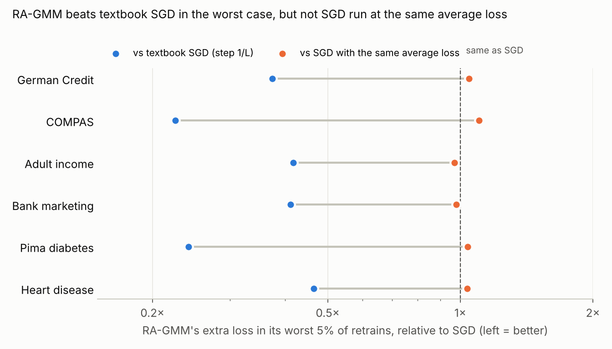

# Who pays for the worst-case retrain? Results

Design: `PLAN.md` (pre-registered). Code: `tail_rows.py`, `make_figure.py`. Raw: `results/<dataset>.json`.
Six datasets, L2 logistic regression (λ = 0.01, batch 16, K = 2,000), 1,000 retrains per method on identical
minibatch sequences. **Tail models** = the 50 retrains (5%) with the highest training objective. For each training row
(person) `X_i` = that person's extra loss in the tail models, `ℓ_i(w_K) − ℓ_i(w*)`, averaged over the 50.

## 1. The worst-case loss falls on unusual people

Profile of the 5% of people with the largest `X_i` under textbook SGD, versus everyone else:

| Dataset | Share of the tail's extra loss carried by these 5% | Who they are (top rows vs rest) | Leverage (median ratio) | Rarest-category frequency (median) |
|---|---|---|---|---|
| Adult income | **58%** | born outside the US: 89% vs 6% (Canada, India, England, Cuba…) | 15.6× | 0.2% vs 4.8% |
| Bank marketing | 45% | contacted during the low-rate period (Euribor 1.1 vs 3.8; employment change −2.1 vs +0.2), previously contacted (82% vs 10%) | 5.9× | 1.7% vs 10% |
| COMPAS | 32% | juvenile records (misdemeanours 1.3 vs 0.03 on average; felonies 0.7 vs 0.02), more priors (7.8 vs 3.0), younger (27 vs 35) | 8.2× | (one categorical only) |
| Pima diabetes | 29% | extreme measurements: insulin 316 vs 68, skin thickness 37 vs 20, glucose 146 vs 120 | 2.2× | (no categoricals) |
| Heart disease | 25% | rare test results (`ca = 4`: 18% vs 0%; `restecg = 0`: 82% vs 46%), higher cholesterol | 3.9× | – |
| German Credit | 20% | unemployed (29% vs 4%), co-applicant (20% vs 2%), management/self-employed (43% vs 14%), rare loan purposes | 2.4× | 3.3% vs 9.6% |

**The common thread:** the people who pay for a bad retrain are those who look unlike most of the training data:
rare categories or extreme values. In model terms they have high **leverage** (their prediction depends on directions
in weight space that the data pins down poorly, i.e. low curvature). Those are exactly the directions in which
noisy training wanders the most, so these people's predictions swing the most from one retrain to the next.

* Leverage predicts a person's tail loss better than how hard the person is for the exact model (Spearman with
  leverage 0.51–0.77 vs with |margin| 0.11–0.65 in absolute value; heart is the exception, 0.71 vs 0.74).
* Rarer people lose more (Spearman of `X_i` with rarest-category frequency −0.36 German, −0.48 Adult, −0.53 Bank).
* They are often people the exact model is *not* getting wrong (Adult: 27% misclassified by the exact model; COMPAS
  32%, the same as everyone else), so this is not "hard examples": it is people the training process treats unstably.
* Race and sex were removed from every dataset, but the effect lands on correlated groups anyway (Adult: immigrants;
  COMPAS: young people with juvenile records). This is a fairness-relevant observation about *retraining variability*;
  it is not a measurement of bias in the exact model.

## 2. With a careful optimizer the pattern changes

With tuned SGD + tail averaging the absolute tail is about 100–400× smaller (e.g. German CVaR₅% of the objective
0.0015 vs 0.37), the leverage effect almost disappears (Spearman 0.07–0.17), and the top rows become the
**borderline / misclassified** people instead (misclassified by the exact model: 31–89% of the top rows). The
residual instability is the usual noise around the decision boundary, not a group-level effect.

## 3. SGD vs RA-GMM: distributions and the worst case

| | German | COMPAS | Adult | Bank | Pima | Heart |
|---|---|---|---|---|---|---|
| RA-GMM tail loss ÷ textbook SGD tail loss | 0.37 | 0.23 | 0.42 | 0.41 | 0.24 | 0.46 |
| RA-GMM tail loss ÷ SGD at the **same average** objective | 1.05 | 1.10 | 0.97 | 0.98 | 1.04 | 1.04 |
| Tail heaviness CVaR₅%/mean: RA-GMM / matched SGD | 1.65 / 1.53 | 2.70 / 2.50 | 1.39 / 1.39 | 1.70 / 1.74 | 2.65 / 2.63 | 2.09 / 1.94 |
| Same top-5% people, RA-GMM vs textbook SGD (Jaccard) | 0.30 | 0.26 | 0.75 | 0.37 | 0.00 | 0.22 |

* **Against textbook SGD, RA-GMM cuts the worst-case extra loss by 54–77%** on every dataset, and on the people SGD
  hurts most by 53–98%.
* **Against SGD run at the same average loss** (step size set so the mean objective matches RA-GMM's), RA-GMM's worst
  case is the same within −3% to +10%, and its tail is as heavy or slightly heavier (CVaR/mean higher on 4 of 6). So
  the whole worst-case improvement comes from RA-GMM's smaller effective step, which also lowers the average; the
  distribution's *shape* is not improved. A one-parameter change to SGD's step size reproduces it.
* The individual people hurt differ between methods (Jaccard 0.00–0.37 except Adult 0.75), but the **kind** of people
  does not: the same rare groups and extreme values head the profiles for every method (e.g. COMPAS: juvenile counts;
  Adult: country of birth; Bank: the low-rate period).

## Hypotheses

| | Result |
|---|---|
| **H1** top 5% of people carry ≥ 25% of the tail's extra loss on ≥ 4/6 | **Supported, 4/6** (Adult 58%, Bank 45%, COMPAS 32%, Pima 29%; Heart 24.7%, German 20.5% just below). |
| **H2** top people are high-leverage (≥ 2×) and leverage beats \|margin\| as a predictor on ≥ 4/6 | **Supported**: leverage ratio 2.2–15.6× on 6/6; leverage the better predictor on 5/6. |
| **H3** same people across methods (Jaccard ≥ 0.5) | **Not supported** (only Adult). Same groups, different individuals. |
| **H4** RA-GMM lower than textbook SGD; lower than matched-mean SGD | **First part supported** (0.23–0.46×); **second part not** (0.97–1.10×). |

## What this means

1. **A concrete, explainable product insight:** "the worst retrains of your model are paid for by your unusual
   customers": people from small groups or with extreme values. A tool can name them in advance from the data
   alone (leverage and rarity are computable from one exact fit, no retraining needed) and that prediction is checkable.
2. **The honest claim about RA-GMM:** it improves the worst case relative to textbook settings, but no more than simply
   taking a smaller SGD step. Do not present it as reshaping the distribution.
3. **The fix that removes the group effect** is a careful optimizer (tuned step + tail averaging): the tail shrinks by
   two orders of magnitude and stops concentrating on rare groups.

## Caveats

* Losses are measured on training rows (the objective the theory controls); held-out behaviour was measured in Gate 0.
* "Matched mean" is matched on 100 tuning seeds; on the evaluation seeds the means differ by ≤ 5%.
* Feature profiles are descriptive (standardized mean differences), not causal.
* COMPAS has one categorical feature and Pima none, so "rarity" is only informative for German, Adult, Bank and Heart.
